<p align="center">
  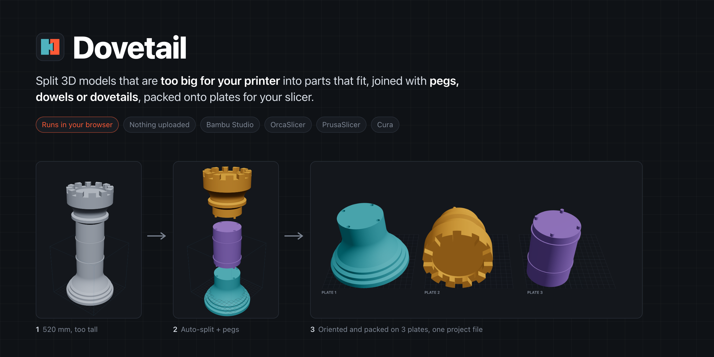
</p>

<p align="center">
  <b>Split 3D models that are too big for your printer into parts that fit.</b><br>
  Auto-placed cuts, pegs, dowels or dovetails, and plates ready for Bambu Studio, OrcaSlicer, PrusaSlicer or Cura.<br>
  Runs entirely in your browser. Your files never leave your machine.
</p>

<p align="center">
  <a href="LICENSE"></a>
  
  
</p>

---

<p align="center">
  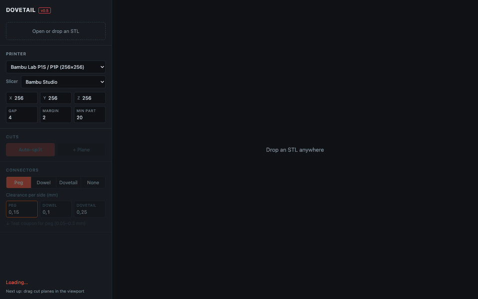
</p>

## Why

Big prints don't fit on a 256 mm bed, let alone a 180 mm one. Splitting them in a slicer or CAD tool means placing every cut by hand, adding alignment features yourself, then arranging the parts on plates. Dovetail does all of it in one place:

1. **Drop an STL.** It checks the size against your printer.
2. **Click Auto-split.** Cuts land where the model is thin, not on an arbitrary grid.
3. **Pick a connector.** Pegs, dowels or dovetails are added to every cut face with the right clearance.
4. **Export.** Each part is laid flat and packed onto plates, delivered as one slicer project.

## Features

| | |
|---|---|
| **Smart auto-split** | Fits any bed. Cuts slide to small cross-sections and away from feature edges, so you don't get slivers. [How it works →](docs/how-it-works.md#auto-split) |
| **Manual planes** | Add planes on X, Y or Z, move them, and tilt them up to ±60° on two axes. |
| **Connectors** | Pegs, dowels (with loose pins) or sliding dovetails, placed automatically on every face. Change the type, size, depth or clearance of any single connector. |
| **Tolerance test coupon** | A small print with six clearances (0.05–0.30 mm) so you can dial in the fit before printing the big parts. |
| **Print orientation** | Every part is laid on its best flat face: most bed contact, least overhang, lowest height. |
| **Multi-plate packing** | Packs real footprints rather than bounding boxes, so parts nest into each other's gaps. Tries several orders and keeps the fewest plates. |
| **Slicer-native export** | One 3MF with the plates already set up for Bambu Studio and OrcaSlicer (36 plates) or PrusaSlicer 2.9+ (9 beds). A per-plate zip for Cura and others, or a plain STL zip. |
| **Printer presets** | 19 printers from Bambu Lab, Prusa, Creality, Elegoo, QIDI and Voron, or a custom bed. Remembered per browser. |
| **Units** | STL has no units. Switch between mm, cm, inch and µm, or type the real length of the longest side. Files over 3 m are assumed to be µm. |
| **Private** | Static site, no server, no upload, no account. Geometry runs in a Web Worker using [manifold-3d](https://github.com/elalish/manifold) compiled to WebAssembly. |

## Screenshots

<table>
  <tr>
    <td width="50%">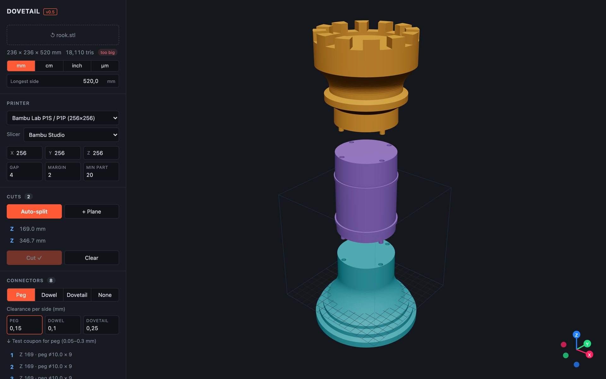<br><sub><b>Auto-split</b>: two cuts, eight pegs, exploded view</sub></td>
    <td width="50%">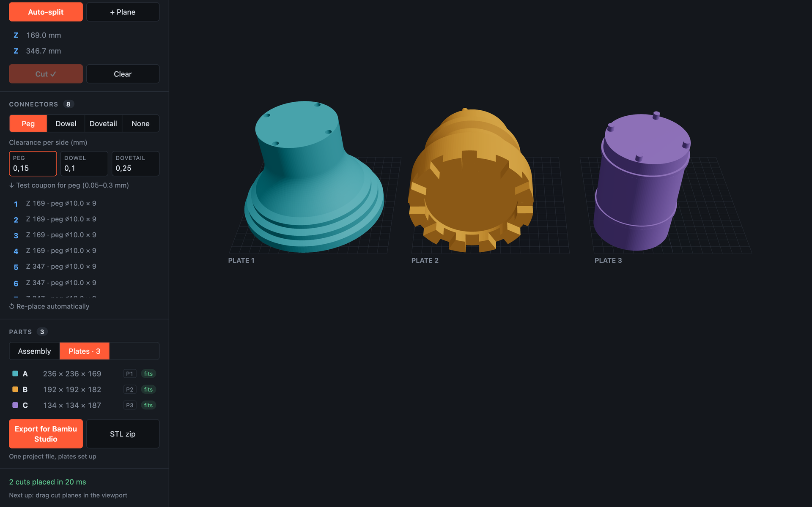<br><sub><b>Plates</b>: each part oriented and packed</sub></td>
  </tr>
  <tr>
    <td>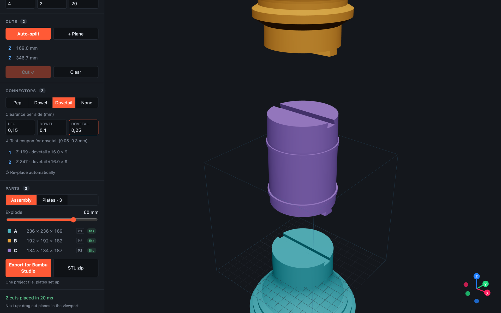<br><sub><b>Dovetails</b>: flared tenons that slide in</sub></td>
    <td>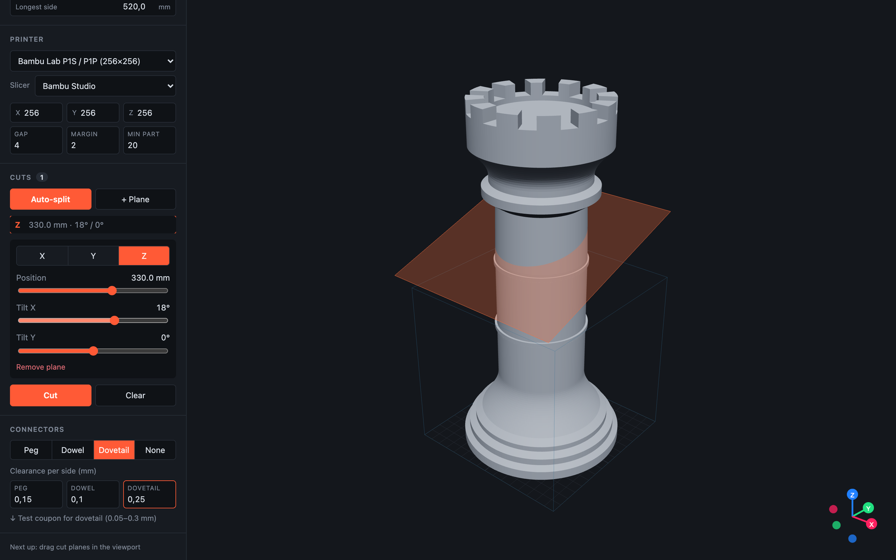<br><sub><b>Manual planes</b>: move and tilt any cut</sub></td>
  </tr>
  <tr>
    <td>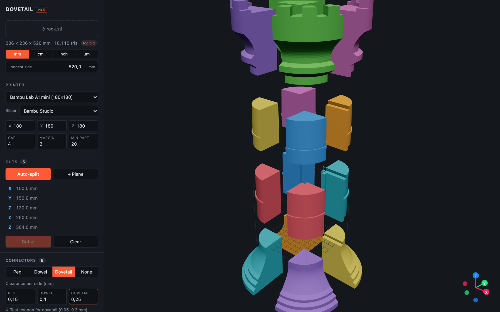<br><sub><b>Small printer</b>: the same rook on a 180 mm bed becomes a 16-part grid</sub></td>
    <td>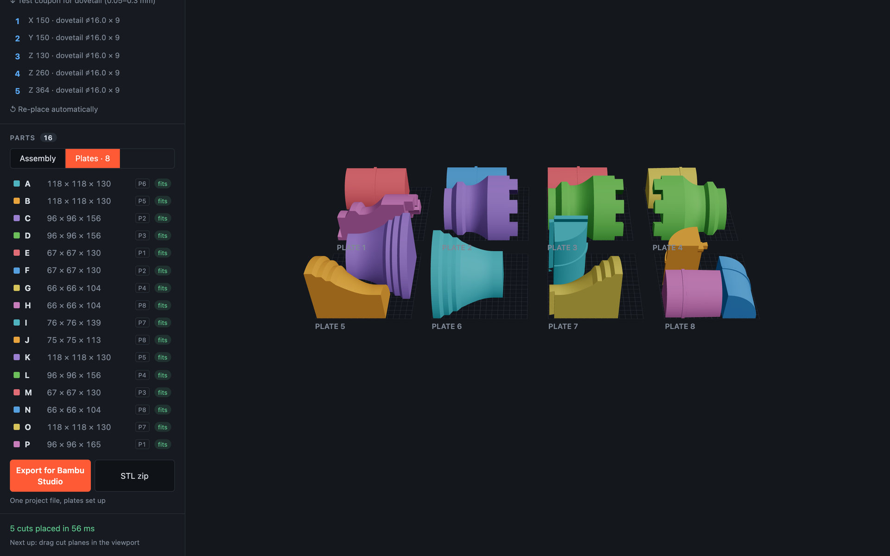<br><sub>…packed onto plates, nested by footprint</sub></td>
  </tr>
</table>

## How it works

<p align="center">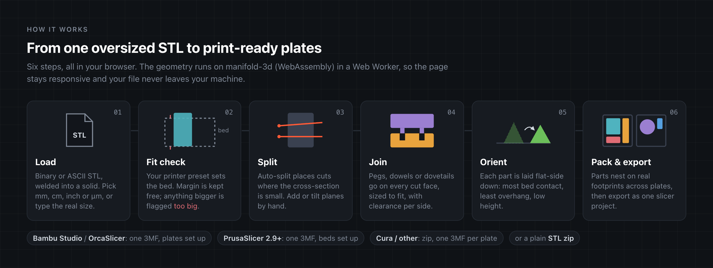</p>

The full write-up, with the algorithms behind each step, is in **[docs/how-it-works.md](docs/how-it-works.md)**. A step-by-step guide to using the app is in **[docs/user-guide.md](docs/user-guide.md)**.

<p align="center">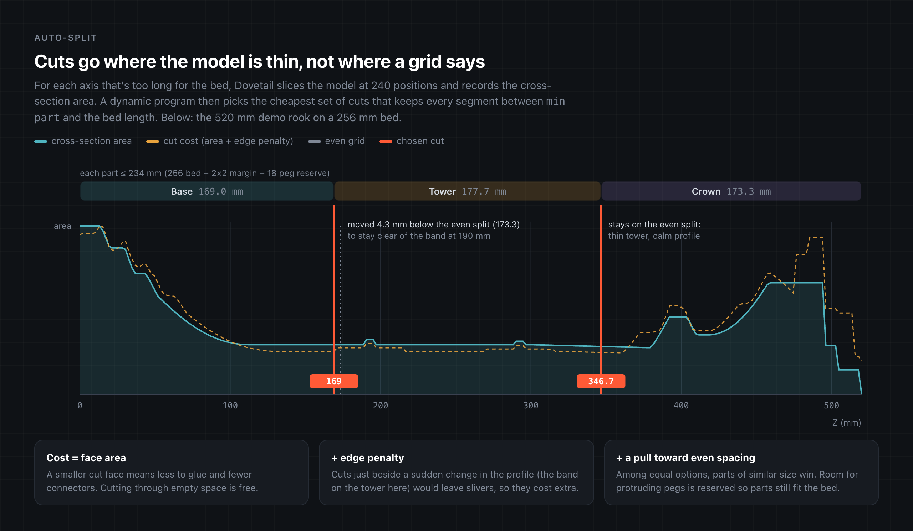</p>

<p align="center">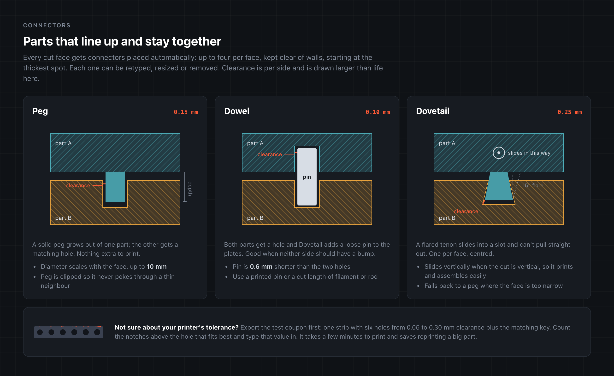</p>

## Run it

You need [Node.js](https://nodejs.org) 20 or newer.

```bash
npm install
npm run dev          # http://localhost:5173
```

Other scripts:

```bash
npm test             # geometry tests (Node, no browser)
npm run build        # static site in dist/
npm run demo:model   # writes demo/rook.stl, the model used in these docs
```

### Self-host

`npm run build` produces a static site in `dist/`. Serve it from any web server that sends `.wasm` files as `application/wasm`. Or use the included Docker image, which serves the build with Caddy:

```bash
docker build -t dovetail .
docker run -d --name dovetail -p 8090:80 --restart unless-stopped dovetail
```

Then open `http://localhost:8090`, or point your reverse proxy at that port.

## Supported slicers

| Slicer | Export | Plates per file |
|---|---|---|
| Bambu Studio | One `.3mf` project with plates | up to 36 |
| OrcaSlicer (also Creality Print, Elegoo Slicer) | One `.3mf` project with plates | up to 36 |
| PrusaSlicer 2.9+ | One `.3mf` project with beds | up to 9 |
| Cura and others | `.zip` with one `.3mf` per plate | any |
| Anything | `.zip` of oriented STLs | any |

If a model needs more plates than the slicer supports, Dovetail exports one file per plate instead and tells you.

## Roadmap

- [x] Load STL, cut with any number of planes (axis + two tilts), split into bodies, exploded view
- [x] Auto-split sized to the bed, cuts placed from the cross-section profile
- [x] Pegs, dowels and dovetails with per-connector edits and a clearance test coupon
- [x] Print orientation and footprint packing across plates
- [x] Printer presets and native multi-plate projects for Bambu Studio, OrcaSlicer and PrusaSlicer
- [ ] Drag cut planes directly in the 3D view

Ideas and bug reports are welcome. See [CONTRIBUTING.md](CONTRIBUTING.md).

## Credits

Built on [manifold-3d](https://github.com/elalish/manifold) for robust mesh booleans, [three.js](https://threejs.org) with [React Three Fiber](https://github.com/pmndrs/react-three-fiber) and [drei](https://github.com/pmndrs/drei) for the viewer, and [fflate](https://github.com/101arrowz/fflate) for zip and 3MF packaging. Plate layouts follow the slicers' own source (Orca's `PartPlate.cpp`, Prusa's `MultipleBeds.cpp`).

## License

[MIT](LICENSE)
