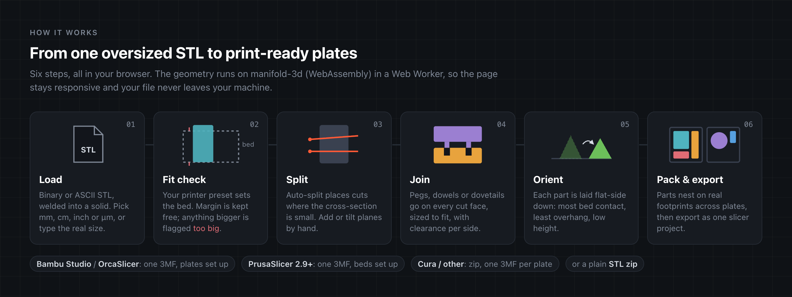
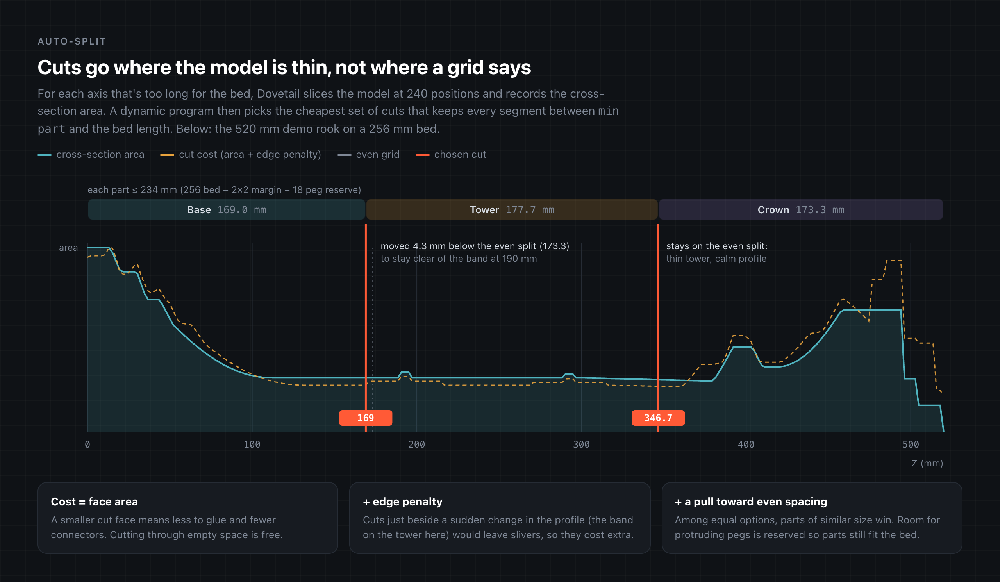
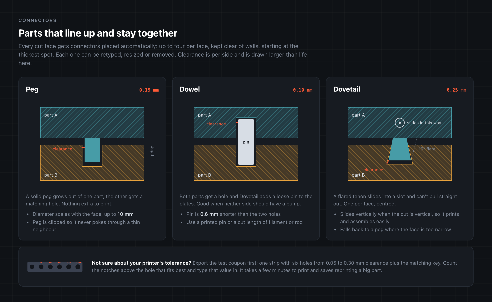

# How it works

Dovetail is a static web app. Everything below happens in your browser; there is no server. This page explains each stage of the pipeline and where it lives in the code.



## Architecture

```
┌──────────────────────── main thread ────────────────────────┐      ┌───────────── Web Worker ─────────────┐
│ App.tsx      side panel, state, export                      │      │ geo.worker.ts                        │
│ Viewer.tsx   three.js scene (React Three Fiber)             │ ───▶ │   manifold-3d (WASM)                 │
│ worker/client.ts   promise RPC: call({ type: 'cut', … })    │ ◀─── │   load · autosplit · cut · pack      │
└─────────────────────────────────────────────────────────────┘      │   coupon                             │
                                                                      └──────────────────────────────────────┘
```

- **UI** (`src/App.tsx`, `src/Viewer.tsx`): React with React Three Fiber. Only holds plain indexed meshes for display.
- **Worker** (`src/worker/`): owns the loaded solid and does every heavy operation, so the page never freezes. Requests and responses are typed in `protocol.ts`; mesh buffers are transferred, not copied.
- **Core** (`src/core/`): pure functions over manifold-3d and typed arrays. The same code runs in the worker and in the Node tests.

| Module | Job |
|---|---|
| `stl.ts` | Read binary and ASCII STL, write binary STL |
| `mesh.ts` | Indexed mesh type, bounding box, vertex welding |
| `ops.ts` | Mesh ⇄ manifold conversion, plane math, cut and split into bodies |
| `autosplit.ts` | Cross-section profiles and cut placement |
| `connectors.ts` | Connector placement, peg/dowel/dovetail booleans, test coupon |
| `orient.ts` | Print orientation candidates |
| `pack.ts` | Multi-plate footprint packing |
| `layout.ts` | Bed-fit check, simple fallback layout |
| `threemf.ts` | 3MF writer |
| `slicers.ts` | Slicer-native multi-plate projects |
| `printers.ts` | Printer presets and the slicer list |

## Load

An STL is a soup of triangles: every triangle repeats its three corners, and nothing says which triangles share an edge. `parseSTL` reads binary or ASCII, then `weld` merges vertices closer than 0.0001 mm into an indexed mesh and drops triangles that collapse. manifold-3d then builds a solid from it, merging any remaining open edges that share positions. If the result isn't watertight, loading fails with an error rather than producing bad cuts later.

STL has no units. If the longest side is over 3000 units the file is assumed to be in micrometres (some CAD tools export that way) and scaled by 0.001. You can override the unit or type the real size; the worker keeps the raw triangle soup so rescaling doesn't need the file again.

## Cut

A cut plane is a unit normal and an offset. In the UI you pick an axis, a position and two tilts (±60°); `planeFrom` rotates the axis normal by the tilts and passes it through the chosen point.

`cutBodies` splits the solid by each plane in turn with manifold's `splitByPlane`, then breaks every piece into its disconnected bodies. That matters: one plane through a U shape gives three parts, not two. Manifold's booleans are exact and always return a closed solid, so every part is printable as is.

## Auto-split



Auto-split answers two questions: how many cuts each axis needs, and where exactly to put them.

**How many.** The usable bed is the bed minus the margin on each side. For pegs and dovetails, which stick out of a cut face, it also reserves room for the protrusion so a part with a peg still fits. Model X and Y can go to either bed axis, so both assignments are tried and the one with fewer cells wins. An axis that's longer than its usable length needs at least `⌈length ÷ usable⌉ − 1` cuts.

**Where.** For each such axis, `crossSectionProfile` slices the solid at 241 evenly spaced positions and records the area of each slice. Every candidate position gets a cost:

```
cost(i) = area(i) / maxArea                       smaller face = less to join
        + 0.8 × maxChangeNearby(i) / maxArea      sudden change within ±min part = slivers
        + 0.15 × |pos(i) − evenGridPos| / maxSeg  tie-break toward similar part sizes
```

Cutting through empty space costs nothing, so cuts happily fall into gaps between features. A dynamic program then picks positions for all cuts on that axis at once, minimising the total cost subject to every segment being at least `min part` and at most the usable length. If no solution exists with the minimum number of cuts, it tries one, two or three more; if that still fails it falls back to an even grid.

On the demo rook (520 mm, 256 mm bed) the even split would be at 173.3 and 346.7 mm. The first cut moves down to 169 mm because 173.3 is within `min part` of the decorative band at 190 mm, where the profile changes sharply. The second stays on the even split: the tower there is thin and plain.

## Connectors



### Placement

For every cut plane, `planeSection` takes the solid's cross-section on that plane in 2D. Each separate region of the section (a hollow model can have several) is handled on its own:

1. **How thick is it?** A binary search on inward offsets finds the largest inset at which the region still has area, roughly half its thinnest width.
2. **How big can a connector be?** Peg and dowel radius is `0.55 × (thickness − 1.2 mm wall − clearance)`, capped at 5 mm. Regions too thin for a 1.2 mm radius are skipped and reported.
3. **Where?** The region is shrunk by `radius + clearance + wall`, so a connector anywhere inside it keeps a wall around it. The first connector goes to the thickest spot; the rest are spread by farthest-point sampling over a grid of candidates. Long faces get more connectors, up to four.
4. **How deep?** `max(4, 2.2 × radius)`, capped at 45% of `min part` so it never reaches through a short part.

Dovetails get one per region, centred. The tenon slides vertically when the cut is vertical (so it prints and assembles naturally), otherwise along the face's short side. Its narrow width is 30% of the room across the slide, at most 16 mm, with a 15° flare. If the face is too narrow, that region gets a peg instead.

### Application

`applyConnectors` decides which body is on which side of the plane by probing a point just above and just below the connector. Then:

- **Peg**: a cylinder is added to the body on the `+normal` side, clipped to the other body so it never pokes through a thin neighbour. The other body gets a hole `clearance` wider all round and `clearance` deeper.
- **Dowel**: both bodies get a hole of `radius + clearance`; a separate pin, 0.6 mm shorter than the two holes together, is added to the parts list.
- **Dovetail**: a trapezoid is extruded along the slide direction. The tenon is added to one body (clipped to where the other has material) and the slot, offset outward by `clearance` with mitred corners, is subtracted from the other.

Changing a connector's size, type or clearance re-runs the cut with the edited list, after a short delay so sliders stay responsive.

### Test coupon

`makeCoupon` builds one strip with six holes or slots at 0.05, 0.10, 0.15, 0.20, 0.25 and 0.30 mm clearance. Small notches on the top edge count 1 to 6 so you can tell them apart after printing. The matching key (peg tab, pin or dovetail tab) is exported with it.

## Orient

Every part is laid down before packing. `orientCandidates` groups triangles by normal to find flat faces and scores putting each one on the bed:

```
score = 3.0 × overhang / totalArea      downward faces (steeper than 45°) not on the bed
      − 1.5 × contact / totalArea       area touching the bed
      + 0.6 × height / longestSide      lower is steadier and faster
```

Orientations that don't fit the bed are dropped unless nothing fits. The part is then turned around Z to its minimum-area bounding rectangle (rotating calipers on the convex hull). Up to three distinct candidates are kept for the packer.

## Pack

Bounding-box packing wastes space around L shapes and round parts. `pack.ts` rasterises each candidate's real footprint (its XY projection) on a grid of about 160 cells across the bed, dilated by the gap between parts. Parts are placed bottom-left, trying all candidate orientations and four 90° rotations, on every open plate before opening a new one.

Greedy packing depends on the order parts arrive in, so it runs several orders (largest area, longest side, largest box, plus deterministic shuffles) and three strategies, and keeps the run with the fewest plates. The same input always packs the same way.

A part that fits no plate in any orientation gets a plate of its own and is flagged.

## Export

Each slicer works out which plate an object belongs to from where it sits in one shared world, so `slicers.ts` places every part at its plate's origin plus its spot on that plate, using each slicer's own layout:

| Slicer | Plate grid (from the slicer's source) | Limit |
|---|---|---|
| Bambu Studio / OrcaSlicer | `⌈√n⌉` columns, pitch = bed × 1.2, rows toward −Y (`PartPlate.cpp`). Plates are declared in `Metadata/model_settings.config`. | 36 |
| PrusaSlicer 2.9+ | Spiral grid, gap = min(100 mm, 0.3 × bed diagonal) (`MultipleBeds.cpp`) | 9 |
| Cura / other | No multi-plate 3MF: a zip with one 3MF per plate | — |

Over the limit, the export falls back to one file per plate. 3MF files are written by `threemf.ts` and zipped with fflate. **STL zip** writes one binary STL per part and pin, already oriented.

## Tests

`npm test` runs the geometry tests in Node with no browser: STL round trips and welding, cuts that create several bodies, auto-split, connector application, packing, and the slicer plate layouts. `test/make-*.ts` write sample STLs for trying the app by hand (an arch too big for the bed, a picture frame in 1/100 mm, a plate in micrometres).
