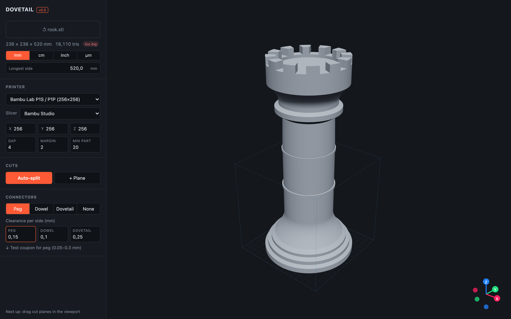
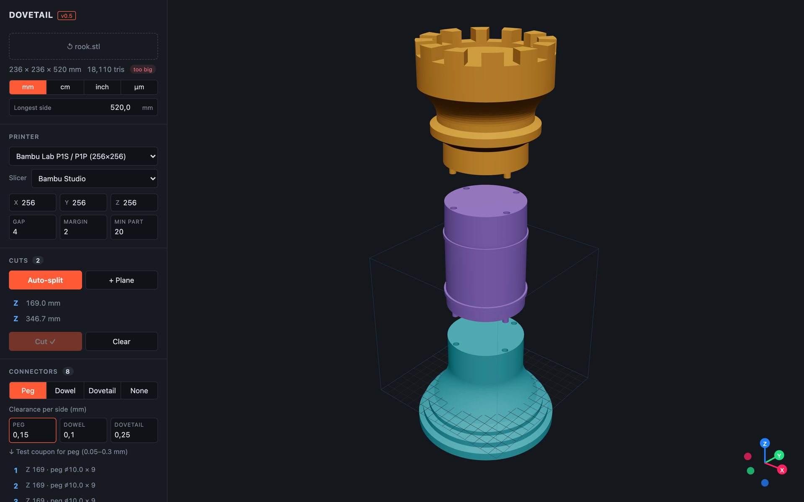
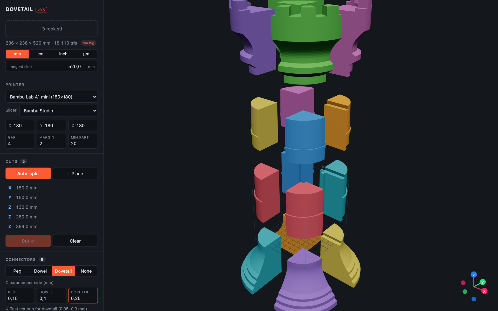
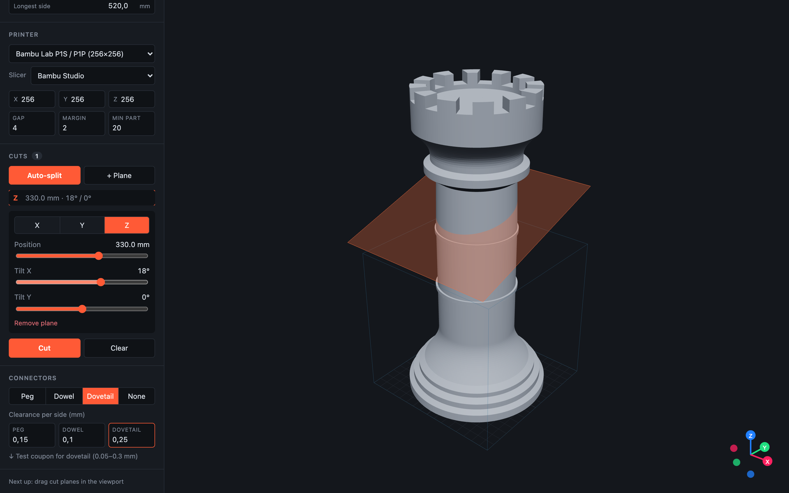
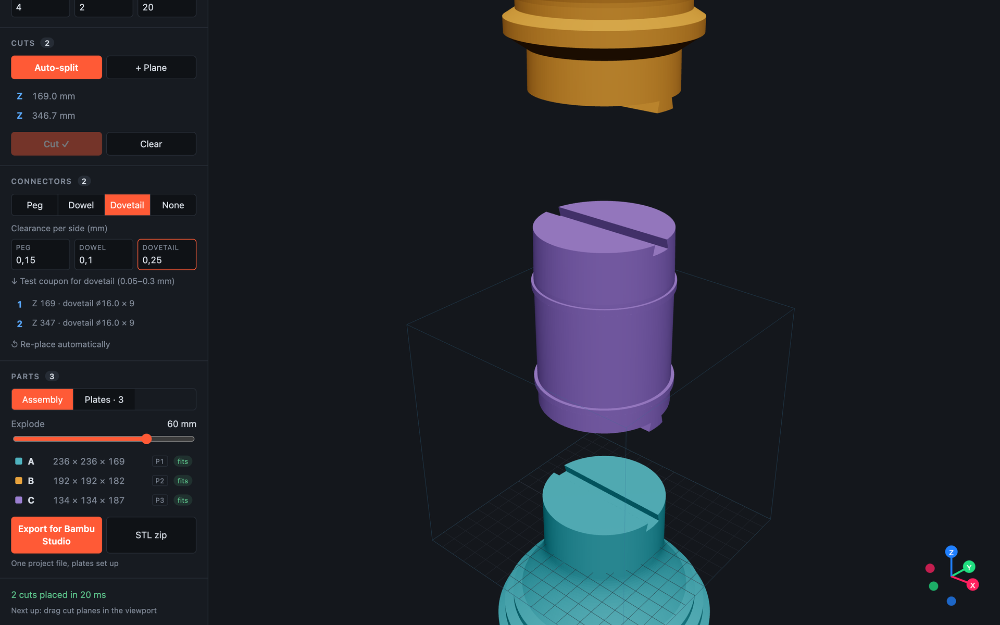
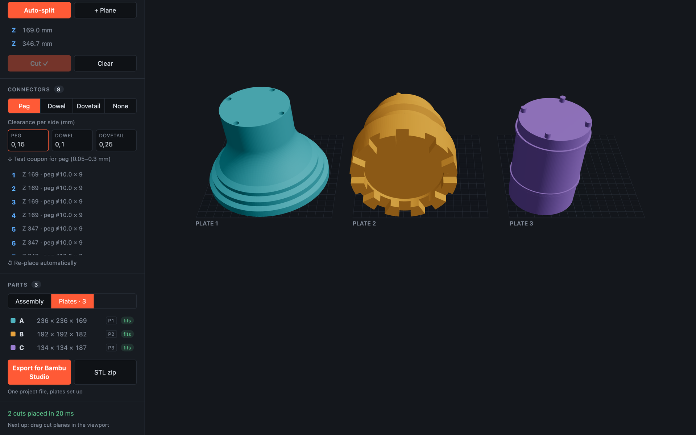

# User guide

A walk through splitting a model, from file to slicer. The screenshots use the demo chess rook (520 mm tall); you can make it yourself with `npm run demo:model`.

## 1. Open a model

Drop an STL anywhere on the page, or click **Open or drop an STL**. Binary and ASCII STL both work.

Under the file name you'll see the model's size, triangle count and a fit badge:

| Badge | Meaning |
|---|---|
| <code>fits</code> | Fits the bed as it is |
| <code>fits rotated</code> | Fits if turned 90° on the bed |
| <code>too big</code> | Needs cutting |

**Units.** STL files carry no units, so check the size. If it's wrong, switch between **mm / cm / inch / µm**, or type the real length of the longest side into **Longest side**. Files whose longest side is over 3 m are assumed to be in micrometres, which is what some CAD tools export.

## 2. Choose your printer

Pick your printer from the list; it sets the bed size and the slicer you'll export to. Choose **Custom bed size** to type X, Y and Z yourself. Your choice is remembered in this browser.

| Setting | What it does | Default |
|---|---|---|
| **Gap** | Space between parts on a plate (mm) | 4 |
| **Margin** | Space kept free around the edge of the bed, for brims and skirts (mm) | 2 |
| **Min part** | Smallest part auto-split may create, and how far cuts stay from a feature edge (mm) | 20 |

## 3. Split

### Auto-split

Click **Auto-split**. Dovetail works out how many cuts each axis needs and places them where the model's cross-section is small, away from sudden changes in shape. The model is cut straight away and the parts appear in an exploded view.

Use the **Explode** slider to pull the parts apart or put them back together. Hover a part in the list to highlight it.

The same model on a smaller printer gets a grid of cuts:

### Manual planes

Click **+ Plane** to add a cut on the model's longest axis, or click any plane in the list to edit it:

- **X / Y / Z** picks the axis the plane is perpendicular to
- **Position** moves it along that axis
- **Tilt** rotates it up to ±60° around the two other axes

The active plane is drawn in orange, the others in blue. Click **Cut** to apply. Editing any plane clears the last cut, so you can try ideas freely. **Clear** removes all planes.

## 4. Connectors

Pick **Peg**, **Dowel**, **Dovetail** or **None**. Connectors are placed on every cut face automatically and re-placed when you change the type.

| Type | What you print | Default clearance |
|---|---|---|
| **Peg** | A peg on one part, a hole in the other | 0.15 mm |
| **Dowel** | Holes in both parts, plus a loose pin | 0.10 mm |
| **Dovetail** | A flared tenon on one part that slides into a slot in the other | 0.25 mm |

Clearance is **per side**: a 10 mm peg with 0.15 mm clearance goes into a 10.3 mm hole.

### Edit a single connector

Click a connector in the list to select it. A ring marks it in the 3D view. You can:

- change its type
- change its **Diameter** (pegs, dowels) or **Width** (dovetails) and **Depth**
- set a **Clearance override** just for this one
- **Remove** it

**Re-place automatically** throws away your edits and starts again. A connector marked *not applied* couldn't be placed because the face there is too thin.

### Test your clearance first

Printers differ. Before printing a big model, click **Test coupon** to download a small strip with six holes or slots from 0.05 to 0.30 mm clearance, plus the matching key. Count the notches above the hole that fits the way you like and enter that value in the clearance box.

## 5. Plates and export

Once the parts are cut, switch from **Assembly** to **Plates**. Each part is laid on its best flat face and packed onto as few plates as possible. The part list shows which plate each part is on (P1, P2, …).

Click **Export for &lt;your slicer&gt;**:

| Slicer | You get |
|---|---|
| Bambu Studio, OrcaSlicer | One `.3mf` project with every plate set up |
| PrusaSlicer 2.9+ | One `.3mf` project with every bed set up |
| Cura / other | A `.zip` with one `.3mf` per plate |

**STL zip** downloads every part (and pin) as a separate STL, already oriented.

If you need more plates than your slicer supports in one project (36 for Bambu and Orca, 9 for Prusa), you get one file per plate instead.

## Tips

- **Hollow or thin models.** Connectors need wall around them. If many faces are skipped, move or remove planes that cross thin walls, or place cuts by hand where the model is solid.
- **Glue.** Connectors align parts; they aren't meant to hold a heavy model on their own. Use CA glue or plastic weld for a permanent join.
- **Changed printer after cutting?** Dovetail repacks the plates. If a part no longer fits, it tells you to run Auto-split again.
